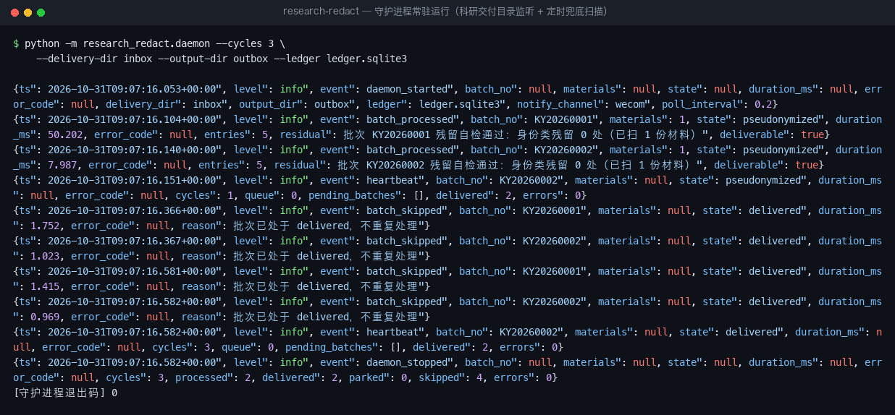
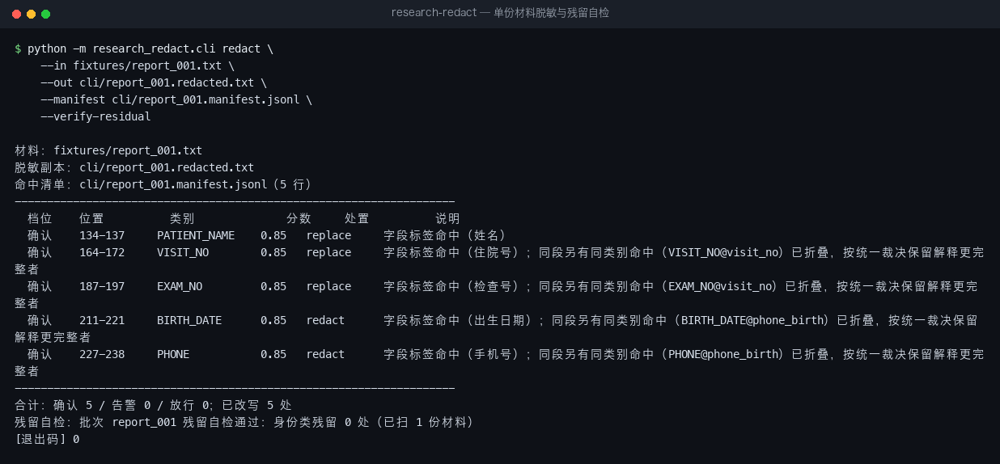
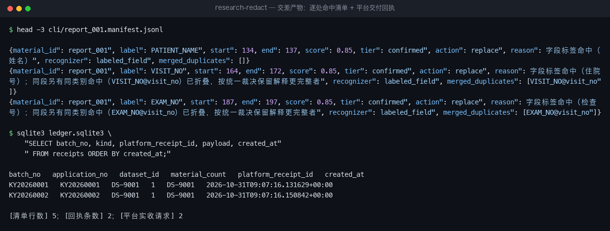
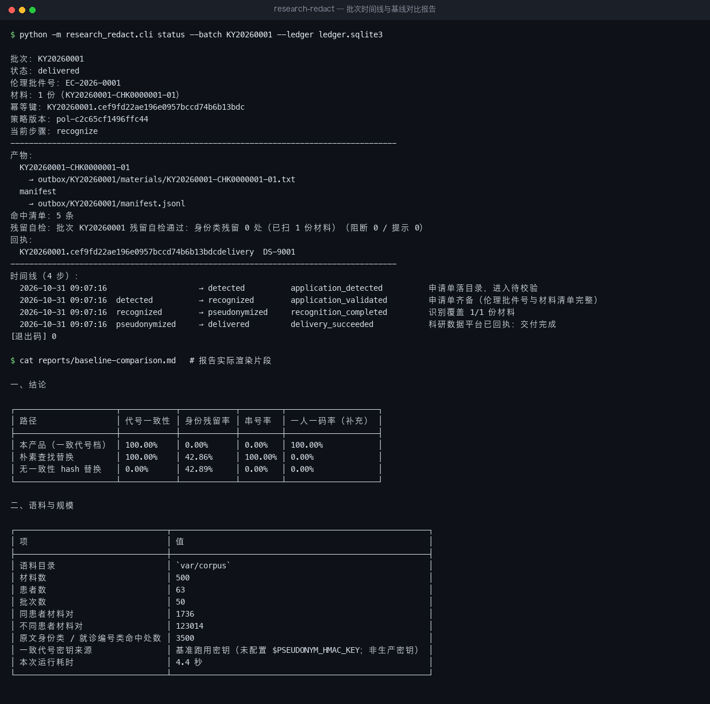

# 科研影像数据脱敏系统

> 科研数据管理员把一批按申请单装好的影像与报告放进交付目录，守护进程把患者身份换成跨材料一致的密文代号，交出一份逐处命中清单并做残留自检，随后交付到科研数据平台；核查需要把某几例换回原文时，必须双人授权并留下一条还原回执。

科研数据的麻烦不在「找得到姓名」，而在**找得到、还认得出**：同一患者在三份报告里出现，换一次号就对不上；剂量、金额、页码长得像住院号，一刀切下去把病名和药名也脱了；脱完没人知道漏没漏。本系统只做这一段——**把一批材料变成能直接交出去的那一份**，并且每一步都留得下痕迹。

## 适用场景 / 目标岗位

| 岗位 | 什么时候用 | 得到什么 |
|------|------------|----------|
| 科研数据管理员 | 按伦理批件把一批影像与报告装进交付目录之后 | 一份能直接交出去的脱敏副本、一份逐处命中清单、平台侧交付回执 |
| 伦理办 | 复核某批次的处置是否落在批件范围内 | 该批次每一处改动的说明与残留自检结论 |
| 信息科 | 每天看守护进程有没有积压或失败批次 | 批次时间线、失败原因、待投递队列长度 |
| 科研数据管理员 | 伦理或数据核查要求把某几例换回原文 | 双人授权后的一次受控还原 + 一条还原回执 |

> 抽检复核是可选动作，**不是**放行闸门：伦理批件号齐备且残留自检无告警即自动投递。

## 能力要点

- **同一患者在所有材料里换成同一个代号**，跨报告、跨影像都对得上号——代号由密钥化的患者主键派生，不是随机数（设 `RESEARCH_POLICY_PROFILE=pseudonym` 启用一致代号档；默认档换成就地占位符）。
- **病名、药名、剂量、金额、页码不会被误脱**——数字类按位数、前缀与邻近词消歧，白名单兜底检验项目名与科室名。
- **脱完自动再扫一遍**：身份串有漏网的，批次直接挡住不投递并告警，不会悄悄交出去。
- **缺伦理批件号就拦住**，主索引取不到就挂起——绝不降级成「按姓名硬脱」放行。
- **同一批材料重复投递只交一次**：幂等键挡住重复外发，进程重启从断点接着跑。
- **换回原文必须两人授权且限时**：过期、越权、单人一律拒绝，并留下访问留痕。

## 快速开始

### 依赖

- Python **3.11+**（开发与验证使用 3.11）
- 运行依赖：`pyyaml`、`httpx`、`openpyxl`、`pydantic`、`cryptography`；开发依赖：`pytest`
- 不需要 GPU，不需要模型权重，**全链路确定性**（不引入任何语言模型）

### 安装

```bash
cd research-data-redact
python3.11 -m venv .venv && source .venv/bin/activate
pip install -e ".[dev]"          # 装本包（src 布局）+ 开发依赖
# 不想装包也可以，把源码目录挂到路径上即可：
# export PYTHONPATH="$PWD/src"
```

### 配置

复制凭据位模板并填入本院端点；**所有密钥只从环境变量读取，代码里不写死**。

```bash
cp .env.example .env
# $EDITOR .env     # 填 HIS_BASE_URL / RESEARCH_DATA_BASE_URL / 令牌 / HMAC 密钥 / 企微 webhook
set -a && . ./.env && set +a
```

配置分两类，缺哪类都不影响进程启动：

| 类别 | 变量 | 缺失时 |
|------|------|--------|
| 端点与凭据 | `HIS_BASE_URL` `HIS_API_TOKEN` `RESEARCH_DATA_BASE_URL` `RESEARCH_DATA_TOKEN` `PSEUDONYM_HMAC_KEY` `INDEX_ENCRYPTION_KEY` `WECOM_WEBHOOK_URL` | 对应通道**置挂起并告警**，进程照常跑，**不静默改指本地替身** |
| 本机路径与档位 | `RESEARCH_DELIVERY_DIR` `RESEARCH_OUTPUT_DIR` `RESEARCH_LEDGER_DB` `RESEARCH_INDEX_FILE` `RESEARCH_POLICY_FILE` `RESEARCH_POLICY_PROFILE` | 全部有默认值，不改也能跑 |

### 构建与验证

```bash
# 全量测试
pytest tests -q
# 单份材料跑通一遍：产出脱敏副本 + 逐处命中清单 + 残留自检
python -m research_redact.cli redact \
  --in fixtures/report_001.txt \
  --out /tmp/redacted.txt \
  --manifest /tmp/manifest.jsonl \
  --verify-residual
```

### 主命令速查

```bash
python -m research_redact.daemon                    # 启动守护进程（主入口，常驻）
python -m research_redact.daemon --once             # 只跑一轮就退出（调试用）
python -m research_redact.cli scan                  # 扫描交付目录，列出待处理批次与台账状态
python -m research_redact.cli run --batch KY20260001 # 手工处理单个批次（脱敏 → 残留自检 → 投递）
python -m research_redact.cli deliver               # 重投待交付队列（不重跑脱敏）
python -m research_redact.cli status --batch KY20260001   # 打印批次时间线
python -m research_redact.cli verify-residual --batch KY20260001  # 对脱敏副本做残留自检
python -m research_redact.cli export-audit --outbox ./var/outbox --out ./var/outbox/audit-export  # 导出命中清单（三种视图 + 摘要表）
python -m research_redact.cli restore-request --batch KY20260001 --approver-a 张主任  # 提交还原请求（缺第二授权人则挂起等签字）
```

守护进程启动后的**首屏**是一段结构化运行日志：先是配置装载回执（策略表已载入、哪些通道已配置、哪些通道挂起），随后进入心跳行；投递目录里一出现申请单，紧接着打出一行 `batch_processed` 批次结果摘要（材料份数 / 命中身份实体数 / 残留自检结论 / 耗时毫秒）。字段口径见「命令 / API / 配置说明」。

## 命令 / API / 配置说明

### 关键配置项

| 配置项 | 默认值 | 说明 |
|--------|--------|------|
| `HIS_BASE_URL` | 无 | HIS 患者主索引端点；未配置时该通道置挂起并告警 |
| `HIS_API_TOKEN` | 无 | 主索引接口令牌，请求头 `Authorization: Bearer` 携带 |
| `RESEARCH_DATA_BASE_URL` | 无 | 科研数据平台端点；未配置时交付通道置挂起并告警 |
| `RESEARCH_DATA_TOKEN` | 无 | 平台接口令牌 |
| `PSEUDONYM_HMAC_KEY` | 无 | 一致代号密钥；缺失时报错，不降级为无密钥哈希 |
| `PSEUDONYM_KEY_ID` | 无 | 密钥版本号，写入交付体的 `pseudonymization.key_id` |
| `INDEX_ENCRYPTION_KEY` | 无 | 对照索引加密密钥；留空时由主密钥派生并在日志标注 |
| `WECOM_WEBHOOK_URL` | 无 | 企业微信机器人推送地址；未配置时推送通道置挂起 |
| `RESEARCH_DELIVERY_DIR` | `./var/inbox` | 科研交付目录（守护进程监听的入口） |
| `RESEARCH_OUTPUT_DIR` | `./var/outbox` | 脱敏副本与命中清单输出目录 |
| `RESEARCH_LEDGER_DB` | `./var/ledger.sqlite3` | 批次台账（状态 / 回执 / 访问留痕） |
| `RESEARCH_INDEX_FILE` | `./var/index/pseudonym_index.enc` | 对照索引文件，与交付物目录**分离存放** |
| `RESEARCH_POLICY_FILE` | `./policy/research.yaml` | 策略表路径（阈值 / 处置动作 / 白名单） |
| `RESEARCH_POLICY_PROFILE` | 无 | 策略表档位：留空 = 默认档（占位符替换）；填 `pseudonym` = 一致代号档（同一患者跨材料代号恒等） |
| `RESEARCH_ALERT_LEDGER` | `./var/alerts.jsonl` | 批次告警台账（残留自检未通过时落一条，按批次聚合） |

### CLI 子命令

| 命令 | 用途 | 关键参数 |
|------|------|----------|
| `cli scan` | 扫描交付目录，列出待处理批次与台账状态 | `--delivery-dir`（缺省取 `$RESEARCH_DELIVERY_DIR`） |
| `cli run` | 处理单个批次：脱敏 → 残留自检 → 投递 | `--batch` `--no-deliver`（只脱不投） |
| `cli deliver` | 重投待交付队列（载荷按台账重建，不重跑脱敏） | `--batch`（省略则全量待交付批次） |
| `cli restore-request` | 提交受控还原请求 | `--batch` `--approver-a` `--approver-b` `--scope` `--reason` `--request-id` `--dataset-id` `--out` |
| `cli export-audit` | 导出命中清单三种分组视图与摘要表 | `--manifest` `--outbox` `--batch` `--out` |
| `cli verify-residual` | 对脱敏产物再扫一遍身份类残留 | `--batch` 与 `--in` **必须且只能给一个** |
| `cli status` | 打印批次时间线（每一步迁移的时间与原因） | `--batch`（省略则列出全部批次）`--export-timeline`（导成 JSON，须配 `--batch`） |
| `cli redact` | 单份材料脱敏并出命中清单 | `--in` `--out` `--manifest` `--verify-residual` |
| `cli redact-dicom` | 一份 DICOM 的 tag 级去标识 | `--in` `--out` `--manifest` |
| `daemon` | 常驻守护进程（主入口） | `--delivery-dir` `--output-dir` `--ledger` `--once` `--cycles` `--poll-interval` `--heartbeat-interval` |

### 退出码

运维脚本按退出码分流，不必去解析终端文案：

| 退出码 | 含义 | 典型触发 |
|--------|------|----------|
| 0 | 成功 | 处理完成并已交付 / 队列为空 / 残留自检通过 |
| 2 | 参数或用法错误 | 批次不在交付目录、交付目录不存在、`--batch` 与 `--in` 同时给 |
| 3 | 处理失败 | 申请单读不出来、脱敏报错、对照索引不可达 |
| 4 | 残留自检未通过 | 该批不得投递（告警已落台账） |
| 5 | 投递未完成 | 通道挂起、退避重试未成功，批次挂起等重投 |
| 6 | 还原授权不足或被拒 | 授权人不在名单、两人同一人、授权过期、超范围 |

### 错误与降级

| 场景 | 表现 | 处理方式 |
|------|------|----------|
| 缺伦理批件号 | 批次置 `blocked`，列出缺失字段 | 不投递、不放行，推送告警 |
| 主索引不可达 | 批次置 `suspended` | 挂起告警，**不降级**为按姓名硬脱 |
| 平台返回 5xx | 指数退避重试 ≤ 2 次 | 超次置 `pending_delivery` 并推送，不静默丢弃 |
| 平台返回 4xx / 鉴权失败 | 直接报错 | 不重试，错误码分类后告警 |
| 端点未配置 | 该通道置挂起 | 告警并标注「未配置」，**不静默改指本地替身** |
| 还原授权不足 | 置 `restore_rejected` | 单人 / 过期 / 超范围一律拒绝并留痕 |
| 还原缺第二授权人 | 批次置 `restore_pending`（挂起等签字） | **不降级**为单人还原；补 `--approver-b` 后重跑同一条命令 |
| 对照索引不可达 | 批次置 `suspended` | 不重建空索引放行（还原件会缺段却看不出来） |
| 材料键不合三段式 | 交付体校验不过，**不外发** | 指出具体字段；材料键须为「申请单号-院内检查号-材料序号」 |

### 对接现有系统

| 对端 | 方向 | 协议与路径 | 凭据来源 |
|------|------|------------|----------|
| HIS 患者主索引 | 读 | `GET {HIS_BASE_URL}/api/v1/patient-index?visit_no=` | `$HIS_API_TOKEN`（Bearer） |
| 科研数据平台 · 数据集 | 写 | `POST {RESEARCH_DATA_BASE_URL}/api/v1/datasets` | `$RESEARCH_DATA_TOKEN`（Bearer）+ `Idempotency-Key` |
| 科研数据平台 · 还原回执 | 写 | `POST {RESEARCH_DATA_BASE_URL}/api/v1/datasets/{dataset_id}/restore-audit` | `$RESEARCH_DATA_TOKEN`（Bearer） |
| 企业微信机器人 | 推 | `POST $WECOM_WEBHOOK_URL`（文本消息） | `$WECOM_WEBHOOK_URL` |

### 可复现实验与语料脚本

五个脚本都可重复运行、覆盖旧产物；语料获取断网自动降级，实验数字由脚本重跑即可复算。

| 脚本 | 用途 | 关键参数 | 产物 |
|------|------|----------|------|
| `scripts/gen_corpus.py` | 确定性合成中文放射语料（默认取数路径，断网可用） | `--limit`（默认 500）`--seed`（默认 20260101）`--out`（默认 `var/corpus`） | `var/corpus/`：申请单 + 材料 + 主索引名单 + 清单；同种子两次生成逐字节一致 |
| `scripts/fetch_public_set.py` | 可选下载公开去标识化语料（校验 sha256、记录来源与许可） | `--out` `--url` `--sha256` `--name` `--license` `--timeout` `--list-sources` | 语料目录 + `SOURCE.md`（来源 / 许可 / 观测哈希）；断网降级并写 `DEGRADED.json` |
| `scripts/compare_baseline.py` | 与「朴素查找替换」「无一致性 hash 替换」跑三项指标对比 | `--corpus` `--out` `--limit` `--seed` | `reports/baseline-comparison.md` / `.json` |
| `scripts/bench_scale.py` | 500 例识别 + 残留自检的耗时 / 峰值内存 / 条目守恒基准 | `--corpus` `--out` `--json-out` `--threshold-seconds`（默认 120） | `reports/performance.md` / `.json` |
| `scripts/export_manifest.py` | 命中清单三视图导出（与 `cli export-audit` 同实现同口径） | `--manifest`（可重复）`--outbox` `--batch` `--out` | `by-batch/` `by-material/` `by-label/` + `summary.csv` + `index.json` |

> 语料纪律：仓库内只保留**合成语料**与**公开去标识化语料**，不含任何真实患者可识别信息；`fixtures/` 只作单测边界样例，不当语料来源。`scripts/public_sources.json` 里的候选源默认全部禁用——sha256 须由运营方在可信下载后核对填入，脚本不写死一个没核对过的哈希。
>
> 基准脚本超阈值**不静默通过**：以退出码 1 收场并在报告里写明实测值与差距。

## 典型场景

### 场景 1：科研数据管理员按伦理批件交一批影像与报告

1. 按 `var/inbox/<申请单号>/` 放好 `application.json` 与 `materials/` 下的材料文件；
2. 守护进程自动取批处理，产出脱敏副本、逐处命中清单并投递到平台；管理员把回执与清单一起归档给伦理办。

```bash
# 交付目录结构
mkdir -p var/inbox/APP-2026-1031/materials
cp application.json var/inbox/APP-2026-1031/
cp materials/*.txt var/inbox/APP-2026-1031/materials/
python -m research_redact.cli scan --delivery-dir ./var/inbox   # 确认批次已识别
```

### 场景 2：伦理办复核某批次的处置范围

1. 拿到该批命中清单，按材料、按实体类别、按批次三种视图查看，每条只显示位置 / 类型 / 分数 / 解释，**不显示命中原文**，可放心外发；
2. 残留自检结论显示为 0 才说明这批可以交。

```bash
python -m research_redact.cli export-audit --outbox ./var/outbox --out ./var/outbox/audit-export
python -m research_redact.cli verify-residual --batch APP-2026-1031
```

### 场景 3：核查要求把某几例换回原文

1. 管理员提交还原请求，写明范围与理由，得到一个带时效的还原请求；缺第二授权人时**挂起等签字**，不降级为单人还原；
2. 第二位授权人在院内既有流程内签字后重跑同一条命令（补 `--approver-b`），授权齐备且未过期才执行；系统换回原文并写一条还原回执到平台侧，同时留下访问留痕。

```bash
# 第一步：受理请求（挂起等第二授权人签字）
python -m research_redact.cli restore-request --batch APP-2026-1031 \
  --approver-a 张主任 --scope APP-2026-1031-CHK0000001-01 --reason "伦理核查"
# 第二步：第二授权人签字后执行还原（回执写入平台侧）
python -m research_redact.cli restore-request --batch APP-2026-1031 \
  --approver-a 张主任 --approver-b 李质控 --scope APP-2026-1031-CHK0000001-01 \
  --reason "伦理核查"
```

### 场景 4：信息科排查昨晚积压的失败批次

1. 守护进程心跳里看到待投递队列长度不为 0，或某批次状态停在 `blocked` / `suspended` / `pending_delivery`；
2. 用 `status` 打印该批次的完整迁移时间线，看清它停在哪一步、失败原因是什么；时间线可导成 JSON 附在故障单里。

```bash
python -m research_redact.cli status                          # 列出全部批次与当前状态
python -m research_redact.cli status --batch APP-2026-1031    # 打印这一批的四步时间线
python -m research_redact.cli status --batch APP-2026-1031 --export-timeline --out ./var/timeline.json
```

### 场景 5：交付通道恢复后手工补投

1. 平台侧临时不可用导致批次挂起（状态 `pending_delivery`），运维通道恢复后**不重跑脱敏**、只补投；
2. 补投复用同一把幂等键，平台收到的是同一个数据集，不会重复建一份。

```bash
python -m research_redact.cli deliver                    # 全量补投待交付队列
python -m research_redact.cli deliver --batch APP-2026-1031   # 只补这一批
```

### 场景 6：把 DICOM 影像一并交付

1. 批次里含 DICOM 影像时，守护进程按同一份申请单自动识别 `kind=dicom` 的材料，与文本材料同批处理；
2. 影像走 tag 级去标识：身份 tag 与**全部私有 tag** 清空，检查号等必要 tag 保留，并按 DICOM 标准写入「已去标识」标记与去标识方法；**像素烧录不在本版范围**，含烧录文字的影像仍需人工点检。

```bash
# 单独处理一份 DICOM（tag 级去标识）
python -m research_redact.cli redact-dicom \
  --in fixtures/ct_001.dcm --out /tmp/ct-redacted.dcm --manifest /tmp/ct-manifest.jsonl
```

### 场景 7：报告里混着剂量、金额和页码，怕脱过头

1. 病名、药名、剂量、金额、页码、床号与住院号在字面上很像；本系统按位数、前缀与邻近词消歧，这些**一律不改写**；
2. 想确认本院写法：跑一遍误伤回归语料，看这些条目在命中清单里是「放行」还是干脆没有命中。

```bash
# 想确认本院写法：跑一遍误伤回归语料（90 条病名/药名/科室名/检验项目名）
pytest tests/test_allowlist.py -q
# 白名单、消歧规则、阈值都在 policy/research.yaml 里，改 YAML 即改行为
```

### 场景 8：伦理办把命中清单对外交差

1. 导出按批次 / 按材料 / 按实体类别三种分组视图，外加一张各类别命中数、平均分、告警档与放行档条数的摘要表；
2. 导出件全文经原文扫描，**不含任何命中原文**，可直接随交差材料一起外发；重复导出不会把上次的残留文件留在目录里（清场动作记在 `index.json`）。

```bash
# 与 cli export-audit 同实现同口径
python scripts/export_manifest.py --outbox ./var/outbox --out ./var/outbox/audit-export
# 导出目录结构
#   by-batch/   by-material/   by-label/   summary.csv   index.json
```

## 输出样例

以下片段均取自本仓库 `fixtures/` 下的**合成样例**与真实运行结果（人名、编号、日期均为虚构，与任何真实患者无关）。

### 脱敏副本片段

```
市第一人民医院  放射科检查报告
================================================================
姓名：<患者姓名>      性别：男      年龄：64岁
住院号：<住院号>   科别：呼吸内科
检查号：<检查号>  床位：12床
出生日期：  手机号：
================================================================
检查所见：
  右肺下叶见磨玻璃结节，大小约 8mm，边界尚清晰，未见明显实变。
  双肺纹理清晰，未见胸腔积液，纵隔未见肿大淋巴结。
诊断意见：
  1、右肺下叶磨玻璃结节，性质待定，建议 3 个月后随访复查
  2、2 型糖尿病
建议：
  1、餐后服用盐酸氨溴索口服液 30mL 每日 3 次
  2、疼痛时口服布洛芬缓释胶囊 0.3g
  3、本次检查费用合计 128.50 元
（本页为第 2 页）
报告日期：2026-01-05    报告医师：示例医师
```

> 身份串被换成占位符（一致代号档下换成密文代号 `P-<16 位十六进制>`），**其余临床内容逐字保留**：病名、药名、剂量、金额、页码、床号、报告日期一字不动。

### 逐处命中清单片段

每行一条，只记位置、类型、档位、处置与解释，**不含命中原文**：

```json
{"material_id": "report_001", "label": "PATIENT_NAME", "start": 134, "end": 137, "score": 0.85, "tier": "confirmed", "action": "replace", "reason": "字段标签命中（姓名）", "recognizer": "labeled_field", "merged_duplicates": []}
{"material_id": "report_001", "label": "VISIT_NO", "start": 164, "end": 172, "score": 0.85, "tier": "confirmed", "action": "replace", "reason": "字段标签命中（住院号）；同段另有同类别命中（VISIT_NO@visit_no）已折叠，按统一裁决保留解释更完整者", "recognizer": "labeled_field", "merged_duplicates": ["VISIT_NO@visit_no"]}
```

> 批次级清单的**首行是清单头**（`_manifest_header`），记批次号、策略表版本号、策略内容哈希与本批条数——用于事后核对「这批是按哪版策略脱的」；首行之后才是逐条命中。

### 终端处理摘要

```text
材料：fixtures/report_001.txt
命中清单：/tmp/r15-manifest.jsonl（5 行）
--------------------------------------------------------------------
  档位    位置          类别              分数     处置          说明
  确认    134-137     PATIENT_NAME    0.85   replace     字段标签命中（姓名）
  确认    164-172     VISIT_NO        0.85   replace     字段标签命中（住院号）；同段另有同类别命中（VISIT_NO@visit_no）已折叠，按统一裁决保留解释更完整者
  确认    187-197     EXAM_NO         0.85   replace     字段标签命中（检查号）
  确认    211-221     BIRTH_DATE      0.85   redact      字段标签命中（出生日期）
  确认    227-238     PHONE           0.85   redact      字段标签命中（手机号）
--------------------------------------------------------------------
合计：确认 5 / 告警 0 / 放行 0；已改写 5 处
残留自检：批次 report_001 残留自检通过：身份类残留 0 处（已扫 1 份材料）
```

### 交付回执片段

平台侧数据集回执（写出去的交付体逐字段符合接口规范）：

```json
{
  "application_no": "APP-2026-1031",
  "ethics_approval_no": "EC-2026-0412",
  "dataset_name": "科研影像批次 APP-2026-1031",
  "material_count": 3,
  "materials": [
    {"material_id": "APP-2026-1031-CHK0000001-01", "kind": "report_text", "sha256": "<64 位十六进制>", "storage_uri": "<平台侧存储地址>"}
  ],
  "pseudonymization": {"scheme": "hmac-sha256", "key_id": "key-2026-10"},
  "manifest_uri": "<平台侧命中清单地址>"
}
```

### 还原回执片段

```json
{
  "restore_request_id": "RR-2026-1031-01",
  "dataset_id": "DS-9001",
  "approver_a": "张主任",
  "approver_b": "李质控",
  "scope": ["APP-2026-1031-CHK0000001-01"],
  "reason": "伦理核查",
  "result_summary": "已还原 1 份材料，回填代号 2 处",
  "granted_at": "2026-10-31T10:12:00",
  "expires_at": "2026-11-01T10:12:00"
}
```

> 还原回执只写**还原了几处、哪些材料、谁授权**，不写还原出来的原文；原文只出现在受控还原件本身。授权不齐时回执写「尚待第二授权人签字，未执行还原」，被拒时写「还原被拒：<原因>」——两种情况都留痕，不留空白。

## 概念 / 实测对照

### 视觉目标

`docs/concepts/visual-target.md` 是一张结构化视觉目标卡，锁定本产品**唯一的用户可见面**：终端里的守护进程运行日志。

- **起始态**：配置装载回执逐行打印（策略表已载入、主索引端点已配置、交付通道已配置），随后进入心跳行；
- **首个可用瞬间**：一行批次结果摘要（材料份数 / 命中身份实体数 / 生成代号数 / 残留告警数），下方列出命中清单前几行，只显示位置、类型、置信分；
- **成形态**：常驻日志跑成批次时间线，每批次一行，右侧两列是「待人工确认」与「还原请求（含双人授权状态）」，底部滚动心跳与异常行。

视觉语言：等宽字体；正常态 `#1A7F37`、告警 `#B26B00`、失败 `#B42318`；信息层级三层——批次结果行（唯一加粗 + 左侧竖线）> 命中清单行（缩进灰）> 心跳行（最浅）。**只允许用当前依赖真能做出来的元素**：Python 标准库 `logging` + ANSI 着色 + SQLite，不画图表、不画大屏。

### 实测证据

下面四张**全部是真实运行产物**：守护进程与运维 CLI 真的跑起来、真的把交付体 POST 出去、真的把台账写进 SQLite；截图里每个字都来自命令 stdout 或落盘文件，没有一处是设计稿。



*图 1 · 守护进程常驻会话：两个批次自动处理（`batch_processed`），心跳带队列长度与最近批次状态，已交付批次被兜底扫描跳过（`batch_skipped`）。*



*图 2 · `cli redact --verify-residual`：逐处命中带档位 / 位置 / 类别 / 分数 / 处置 / 解释，合计确认 5 处、已改写 5 处，残留自检身份类残留 0 处。*



*图 3 · 交差产物：命中清单 JSONL 逐行可核（不记命中原文），台账 `receipts` 表里的交付回执与平台实收请求数一一对上。*



*图 4 · 上半：`cli status --batch` 打印的批次时间线（detected → recognized → pseudonymized → delivered 四步迁移与各自原因）；下半：`reports/baseline-comparison.md` 的实际渲染片段（三条路径的代号一致性 / 身份残留率 / 串号率）。*

> **诚实标注**：上为**视觉目标**（`docs/concepts/visual-target.md` 的结构化卡片），下为**真实实测**（上面四张图）。两者**必然有差距**——实测日志是 JSONL 单行长文本、按真实终端宽度折行，而目标卡设想的是「批次结果摘要 + 命中清单前几行」的两段式人读格式；目标卡里「右侧待人工确认 / 还原请求两列」在当前实现中还没有对应界面。**不会**生成事后效果图来抹平差距。

> **采集环境说明**：截图里的对端（科研数据平台 / HIS 患者主索引 / 企业微信机器人）由**本机 HTTP 服务**扮演，产品代码走真 `httpx` 客户端、按 spec 字段规范组装请求体并带 `Idempotency-Key`；院内真实端点尚未接入，截图中的数据集 ID 与回执号均为本机服务返回值。

## 架构与数据流

```
 科研交付目录                  院内 HIS                  科研数据平台
┌────────────────┐      ┌──────────────┐      ┌────────────────┐
│ inbox/<申请单>/ │      │ 患者主索引    │      │ 数据集交付      │
│ application.json│      │ (只读)        │      │ + 还原回执      │
│ materials/*    │      └──────┬───────┘      └───────▲────────┘
└───────┬────────┘             │ 身份锚定(名单)           │ POST /api/v1/datasets
        │ 目录监听 / 兜底扫描    │                        │ Idempotency-Key
        ▼                      │                        │
┌───────────────────────────────────────────────────────┴─────────┐
│ 守护进程 daemon（常驻）  ·  运维 CLI（手动触发）                    │
│  两条触发通道共用同一条主路径与同一张台账（daemon/ops.py）             │
│  ① 识别层   正则 / 校验位 / 名单 / n-gram 邻近窗口                  │
│             逐识别器阈值 + 全局阈值 + 白名单 + 去重                  │
│             ▼                                                     │
│  ② 策略层   实体级处置表 replace / redact / keep / hmac_pseudonym   │
│             一致代号 HMAC（跨材料恒等）+ 冲突区间合并                │
│             ▼                                                     │
│  ③ 残留自检 身份类二次扫描 → 残留非 0 则挡住投递                    │
│             ▼                                                     │
│  ④ 批次状态机 + SQLite 台账   幂等键 / 断点续跑 / 并发互斥           │
└──────────────────────────────┬───────────────────────────────────┘
                               ▼
       ┌──────────────────────────────────────────┐
       │ 产物：脱敏副本 + 逐处命中清单（不含原文）      │
       │       加密对照索引（与交付物分离存放）          │
       └──────────────────────────────────────────┘
                               │ 核查需换回原文：双人授权 + 时效
                               ▼
       ┌──────────────────────────────────────────┐
       │ 还原回执 → POST /restore-audit（写平台侧）   │
       └──────────────────────────────────────────┘
```

### 关键不变量

- **幂等键** = 申请单号 + 材料集合指纹（材料 id 与文件 sha256 排序后哈希）；同一批重复投递不产生第二次外发，材料集合变化则指纹随之变化、不会误判为重复。
- **同一段只替换一次**：跨识别器的重叠 / 包含 / 交叉按「身份类 > 就诊编号类 > 通用数字类，同级高分者胜」统一裁决，被裁剪方记入命中清单但不记原文。
- **失败不静默改数据**：缺批件号置 `blocked`，主索引不可达置 `suspended`，平台 5xx 退避超次置 `pending_delivery`；任何失败都不降级成「按正则硬脱」放行。
- **并发与重放防护**：同一批次互斥处理，材料按 `material_id` 去重，命中清单按 `(批次, 材料, 起点, 类别)` 追加去重；命中清单只记位置 / 类型 / 分数 / 解释，不记原文。

## 安全与合规边界

- 本系统只做**去标识化**与**受控还原**，不产出诊断或治疗建议，不写回电子病历，不替人签字。
- 对 HIS **只读**患者主索引，不直连 PACS；读侧以科研交付目录为输入，不主动抓取院内业务数据。
- 命中清单与导出产物**不记命中原文**，可直接外发；对照索引加密存储、与交付物目录分离存放，解密与查询均留痕。
- 还原为高敏操作：必须两名授权人（不得同人）、在有效期内、且限定材料范围；过期、越权、单人一律拒绝并留痕。
- 仓库内只保留 `.env.example` 模板，不提交任何真实密钥；合成与公开去标识化语料不含任何真实患者可识别信息。

## 验收与自检

| 验收项 | 命令 | 期望结果 |
|--------|------|----------|
| 全量测试通过 | `pytest tests -q` | 全部通过 |
| 单份材料脱敏 | `python -m research_redact.cli redact --in fixtures/report_001.txt --out /tmp/r.txt --manifest /tmp/m.jsonl` | 生成脱敏副本与 JSONL 清单 |
| 命中清单不含原文 | `pytest tests/test_audit_no_rawtext.py -q` | 通过 |
| 身份锚定正确 | `pytest tests/test_entity_binding.py -q` | 同名异人不串号、一人多号归一 |
| 冲突区间只替换一次 | `pytest tests/test_conflict_merge.py -q` | 通过 |
| 残留自检有效 | `pytest tests/test_residual.py -q` | 身份类残留阻断投递 |
| 双人授权还原 | `pytest tests/test_restore_auth.py tests/test_restore_roundtrip.py -q` | 单人 / 过期 / 超范围被拒 |
| 出站契约一致 | `pytest tests/test_outbound_contract.py -q` | 逐字段符合接口规范 |
| 幂等与续跑 | `pytest tests/test_idempotency.py tests/test_resume.py -q` | 重投只外发一次、崩溃后接续 |
| 误伤回归 | `pytest tests/test_allowlist.py -q` | 病名 / 药名 / 科室名 / 检验项目名零误伤 |
| 语料可重跑 | `python scripts/gen_corpus.py --limit 500 --seed 20260101` | 500 份材料；同种子两次生成逐字节一致 |
| 公开集下载降级 | `python scripts/fetch_public_set.py` | 断网时降级到合成集并写 `DEGRADED.json`，退出码仍为 0 |
| 规模基准达标 | `python scripts/gen_corpus.py --limit 500 && python scripts/bench_scale.py` | 500 例识别 + 自检 ≤ 120 秒，条目数守恒 |
| 基线对比可复现 | `python scripts/gen_corpus.py --limit 500 && python scripts/compare_baseline.py` | 三项指标可复算（详见 `reports/baseline-comparison.md`） |
| 清单三视图导出 | `python scripts/export_manifest.py --outbox ./var/outbox --out ./var/outbox/audit-export` | 三视图条数守恒，导出件不含命中原文 |

> 语料与基准脚本依赖 `var/corpus/`（运行时目录，不入库）；`reports/` 下留有已生成的对比与基准报告，重跑脚本即可复算同样数字。

## 项目结构

```
research-data-redact/
├── README.md                          # 中文产品说明（本文件）
├── qrcode.jpg                         # 公众号二维码
├── requirements.txt / pyproject.toml  # 依赖清单与打包配置（src 布局）
├── .env.example / .gitignore          # 凭据位模板 / 排除运行时数据与密钥
├── conftest.py                        # 让 pytest 直接导入 src/ 布局
├── policy/research.yaml               # 策略表：阈值 / 处置动作 / 白名单 / 上下文词表 / 冲突优先级
├── src/research_redact/
│   ├── config.py                      # 环境变量与 YAML 装载（无硬编码密钥，缺端点即挂起通道）
│   ├── models.py                      # 实体区间 / 命中项 / 批次 / 授权 / 回执 数据模型
│   ├── paths.py                       # 项目根目录解析（相对路径的唯一锚点）
│   ├── logging_setup.py               # 结构化日志 + 心跳 + 批次时间线
│   ├── idempotency.py                 # 材料集合指纹与幂等键算法（申请单号 + 材料 sha256）
│   ├── arbitration.py                 # ★ 跨识别器区间统一裁决（重叠 / 包含 / 交叉 / 重合）
│   ├── cli.py                         # 运维子命令（scan/run/deliver/restore-request/…）
│   ├── recognizers/                   # ★ 识别层
│   │   ├── base.py                    #   识别器基类：正则 / 校验位 / 名单 三形态统一产出
│   │   ├── registry.py                #   注册表：逐识别器阈值 + 全局阈值 + 去重 + 白名单
│   │   ├── assembly.py                #   按策略表装配识别器清单（启停与逐项阈值覆盖）
│   │   ├── patient_index.py           #   主索引名单识别器（同名异人 / 一人多号消歧）
│   │   ├── id_card.py                 #   身份证 GB 11643 加权校验位
│   │   ├── visit_no.py                #   住院号 / 门诊号 / 检查号
│   │   ├── phone_birth.py             #   手机号与出生日期
│   │   ├── labeled_field.py           #   字段标签命中（姓名：/ 住院号：…）
│   │   ├── shapes.py                  #   编号形态约束（位数 / 前缀）
│   │   ├── numeric_boundary.py        #   剂量 / 金额 / 页码 / 床号消歧
│   │   └── context_boost.py           #   字符 n-gram 邻近窗口打分（Dice + 局部对齐）
│   ├── policy/                        # ★ 策略层
│   │   ├── table.py                   #   策略表装载与校验（非法配置报错不取默认值）
│   │   ├── operators.py               #   处置动作 replace / redact / keep / hmac_pseudonym / hmac_restore
│   │   ├── conflicts.py               #   冲突区间的策略表口径（优先级逐类别分配）
│   │   ├── pseudonym.py               #   一致代号 HMAC-SHA256 over 患者主索引主键
│   │   ├── mapping.py                 #   对照索引（代号 ↔ 原文）按材料与出现次序分槽
│   │   ├── index_store.py             #   对照索引加密落盘（AES-256-GCM）与访问留痕
│   │   ├── residual_policy.py         #   残留分级口径（阻断级 / 提示级）与误报抑制开关
│   │   ├── snapshot.py                #   策略表版本号与可复现快照（不落密钥）
│   │   └── dicom.py                   #   DICOM tag 保留 / 清空处置表
│   ├── audit/                         # ★ 清单与残留
│   │   ├── manifest.py                #   逐处命中清单（不含原文）+ 三视图导出与摘要表
│   │   ├── residual.py                #   身份类残留分级扫描与批次级聚合
│   │   ├── alerts.py                  #   批次告警落点（台账 / 本地 JSONL）与推送
│   │   └── ledger.py                  #   SQLite 台账：批次 / 迁移 / 回执 / 访问留痕 / 幂等认领
│   ├── daemon/                        # ★ 状态机与主循环
│   │   ├── state_machine.py           #   10 态批次迁移表与守卫（非法迁移拒绝推进）
│   │   ├── pipeline.py                #   唯一主路径：识别 → 处置 → 清单 → 残留自检
│   │   ├── runner.py                  #   单批处理编排（锁、指纹、续跑、投递）
│   │   ├── ops.py                     #   守护进程与 CLI 共用的运行时装配与单批处理
│   │   ├── watcher.py                 #   交付目录监听 + 定时兜底扫描
│   │   ├── queue.py                   #   待投递队列与指数退避重试
│   │   ├── locks.py                   #   批次文件锁 + 线程锁（并发互斥）
│   │   ├── resume.py                  #   断点续跑判定（产物 sha256 与源指纹比对）
│   │   ├── replay.py                  #   按策略快照重放批次并逐条比对
│   │   ├── settings.py                #   守护进程运行参数（轮询间隔、心跳间隔）
│   │   └── __main__.py                #   常驻入口 `python -m research_redact.daemon`
│   ├── ingest/                        # 入站：application.py 申请单 JSON/xlsx 解析与字段校验
│   │   └── columns.py                 #   列级策略（业务列跳过脱敏）
│   ├── materials/dicom_redact.py      # DICOM tag 级去标识（私有 tag 全清，不做像素烧录）
│   ├── outbound/                      # 出站客户端
│   │   ├── patient_index_client.py    #   读 HIS 患者主索引
│   │   ├── research_platform_client.py#   写数据集与还原回执（认领式幂等交付）
│   │   ├── notifier.py                #   企业微信机器人推送
│   │   ├── schemas.py                 #   pydantic 字段规范校验（校验不过不外发）
│   │   ├── retry.py                   #   统一重试策略（连接错误/超时/5xx 退避，4xx 不重试）
│   │   ├── failures.py                #   失败分类 → 批次状态与告警级别
│   │   ├── channels.py                #   通道名单一真源（哪个通道配没配）
│   │   └── errors.py                  #   出站异常类型
│   └── restore/                       # 受控还原
│       ├── authority.py               #   双人授权、名单、时效、范围四道闸
│       └── service.py                 #   还原执行、回执写入与访问留痕
├── scripts/                           # 可重跑的语料获取与可复现实验
│   ├── gen_corpus.py                  #   确定性合成 ≥500 例中文放射 / 检验语料
│   ├── fetch_public_set.py            #   公开去标识化语料可选下载（断网降级）
│   ├── compare_baseline.py            #   与朴素替换 / 无一致性 hash 的三项指标对比
│   ├── bench_scale.py                 #   500 例规模基准（耗时 / 峰值内存 / 条目守恒）
│   ├── export_manifest.py             #   命中清单多视图导出
│   └── public_sources.json            #   公开集候选源清单（sha256 须人工核对后启用）
├── tests/                             # 单测 + 契约测试（协议替身只在测试层）
├── fixtures/                          # 中文放射 / 检验报告样例（仅作边界样例）
│   └── regression/                    #   误伤回归语料（病名 / 药名 / 科室名 / 检验项目名）
├── reports/                           # baseline-comparison.md / performance.md（可复现实验产物）
└── docs/
    ├── concepts/visual-target.md      # 视觉目标卡（结构化，无伪造概念图）
    └── screenshots/                   # 真实运行截图
```

## License

MIT

---

## 关注我们

欢迎扫码关注公众号，获取项目更新与交流加群：

